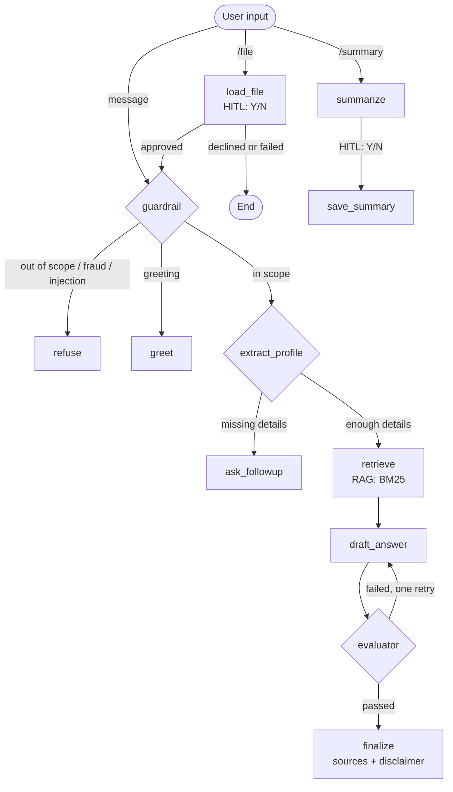

# AI Rights Assistant

A command-line agent that helps residents of Israel discover the social rights and benefits they may be entitled to: National Insurance, labor law, tax, municipal discounts and new-immigrant benefits.

The agent is built as a **LangGraph** workflow and monitored with **LangSmith**. **It converses in Hebrew**, the language of its target users and official sources.

It:
- Understands the user's situation and asks follow-up questions when important details are missing.
- Retrieves relevant rights from a local knowledge base (RAG) and presents them with what to check and a link to the source.
- Refuses off-topic questions, requests to cheat the system and prompt-injection attempts.
- Reads a local file (for example, a termination letter) and exports a conversation summary, both only after a `[Y/N]` approval from the user.

> ⚠️ The agent provides general information only. It is not legal advice and does not replace contacting the competent authority.

---

## Quick start (Windows)

1. Download `agent.exe` from the [Releases](https://github.com/diniveber/ai-rights-assistant/releases) page.
2. In the same folder, create a `.env` file based on [.env.example](.env.example). `OPENAI_API_KEY` is enough; a LangSmith key is optional.
3. Run it from a terminal:
   ```
   agent.exe
   ```

---

## Architecture



| Component | Implementation |
|---|---|
| **Guardrails** | The `guardrail` node classifies every message as `in_scope`, `greeting`, `out_of_scope`, `fraud` or `injection` |
| **Gates** | Conditional edges: out-of-scope requests are refused; missing information leads to follow-up questions (up to 2 rounds) |
| **Evaluator** | The `evaluator` node checks that the answer relies only on the retrieved rights and follows the required format. A failed answer is redrafted once |
| **Human-in-the-loop** | LangGraph `interrupt` with a `[Y/N]` approval before reading a personal file and before writing a summary to disk |
| **Extension: RAG** | Local BM25 search over [agent/data/rights.json](agent/data/rights.json): 19 rights in 9 categories, each with a source link |
| **Conversation memory** | LangGraph checkpointer. Details the user provides accumulate across turns |
| **Monitoring** | LangSmith, configured through environment variables. Eval runs go to a separate project with an `-evals` suffix |
| **LLM provider** | OpenAI by default. Switch to OpenRouter with `LLM_PROVIDER=openrouter` or `--provider openrouter` |
| **Cost tracking** | Every model call is measured as tokens × price and shown per node. Free models also show a theoretical cost |

### Project structure

```
ai-rights-assistant/
├── agent/
│   ├── __init__.py
│   ├── config.py         # providers, models, pricing
│   ├── llm.py            # model factory per provider + cost measurement
│   ├── prompts.py        # prompts for each node
│   ├── graph.py          # LangGraph workflow definition
│   ├── nodes.py          # guardrail, extract, retrieve, draft, evaluator, refuse, HITL...
│   ├── tools.py          # RAG (BM25), file reading, summary export
│   ├── cli.py            # CLI entry point
│   └── data/rights.json  # knowledge base
├── evals/
│   ├── dataset.py        # 10 in-scope + 10 out-of-scope labelled questions
│   ├── judge.py          # LLM-as-judge on a fixed model
│   ├── rubric.md         # judge rubric
│   ├── compare_models.py # eval 1: model comparison
│   ├── cost_eval.py      # eval 2: cost
│   ├── scope_eval.py     # eval 3: professionalism and scope leakage
│   └── results/          # CSV outputs
├── check_setup.py        # verifies keys and connections
├── manifest.json
├── requirements.txt
├── README.md
└── .env.example
```

---

## Installation from source

Requires Python 3.10 or later.

```bash
git clone https://github.com/diniveber/ai-rights-assistant.git
cd ai-rights-assistant
python -m venv .venv
.venv\Scripts\activate          # Linux/macOS: source .venv/bin/activate
pip install -r requirements.txt
copy .env.example .env          # then fill in your keys
python check_setup.py           # checks OpenAI, OpenRouter and LangSmith
```

### Environment variables (`.env`)

| Variable | Description |
|---|---|
| `LLM_PROVIDER` | `openai` (default) or `openrouter` |
| `OPENAI_API_KEY` | OpenAI key |
| `OPENROUTER_API_KEY` | OpenRouter key (a free account is enough for free models) |
| `LANGSMITH_TRACING`, `LANGSMITH_API_KEY`, `LANGSMITH_PROJECT` | LangSmith monitoring |
| `RIGHTS_MODEL` | Optional default model |

---

## CLI usage

```bash
python -m agent.cli                      # from source
agent.exe                                # compiled executable
agent.exe --provider openrouter          # free model through OpenRouter
agent.exe --model gpt-5.4-nano --quiet
```

| Command | Description |
|---|---|
| `help` or `?` | Short usage guide |
| `/file <path> [question]` | Attach a local file (txt, md, pdf, docx). Requires `[Y/N]` approval |
| `/summary` | Summarize the conversation and save it to a text file under `summaries/`. Requires `[Y/N]` approval |
| `/cost` | Accumulated session cost and usage |
| `/models` | List configured models |
| `/reset` | Start a new conversation |
| `/exit` | Quit |

Command-line options: `--model`, `--provider`, `--quiet` (hide node INFO messages), `--debug` (full traceback), `--version`.

### Example session

The conversation is in Hebrew; translations are added here as `#` comments.

```
אתה: פוטרתי                                  # "I was fired"
[INFO] Entering Node: guardrail...
[INFO] Entering Node: extract_profile...
[INFO] Entering Node: ask_followup...
# The agent asks: how long did you work there? Full time? Approximate salary?

אתה: 3 שנים, משרה מלאה                        # "3 years, full time"
[INFO] Entering Node: guardrail...
[INFO] Entering Node: extract_profile...
[INFO] Entering Node: retrieve...
[INFO] Entering Node: draft_answer...
[INFO] Entering Node: evaluator...
[INFO] Entering Node: finalize...
# The answer covers severance pay, advance notice, unemployment benefits and more,
# followed by a source link for each right.

── עלות ושימוש (הודעה זו) ─────────────────────   # cost and usage (this message)
  guardrail           539 in /    63 out    1.9s  $0.00069
  extract_profile     830 in /   287 out    6.9s  $0.00191
  draft_answer       1980 in /   616 out    4.6s  $0.00426
  evaluator          1802 in /   142 out    2.4s  $0.00199
  סה"כ               5151 in /  1108 out          $0.00885
```

(Abridged. The cost figures come from a real `gpt-5.4-mini` run and vary between runs.)

Errors are reported as clear messages in Hebrew: missing or invalid key, unavailable model, rate limit, connection problem or file not found.

---

## Evals

Three evals. Each writes a detailed CSV and a `_summary.csv` to [evals/results/](evals/results/).

```bash
python evals/compare_models.py     # model comparison (LLM-as-judge)
python evals/cost_eval.py          # cost
python evals/scope_eval.py         # professionalism and scope leakage
```

### 1. Model comparison

The same questions run on three models: two paid OpenAI models and one free OpenRouter model.

- **Latency:** measured automatically.
- **Quality and reliability:** an LLM-as-judge scores each answer from 1 to 5 using [evals/rubric.md](evals/rubric.md) on relevance, factual accuracy, completeness, format and reliability. The judge is a single fixed model, **gpt-5.4**, deliberately not one of the compared models, to avoid self-preference bias.
- **Data quality:** precision, recall and F1 of the rights identified, against the rights labelled for each question.

| Model | Questions | Judge score | Reliability | F1 | Avg. latency | Cost per question |
|---|---|---|---|---|---|---|
| gpt-5.4-mini | 10 | **4.86** | **5.0** | **1.00** | **10.1 s** | $0.0087 |
| gpt-5.4-nano | 10 | 4.56 | 4.6 | 0.96 | 15.2 s | **$0.0030** |
| nemotron-3.5-super-vl:free | 6 | 4.67 | 4.17 | **1.00** | 81.7 s | $0 (theoretical $0.0043) |

**Conclusions**
- **gpt-5.4-mini** had the highest quality and was the fastest, so it is the default.
- **gpt-5.4-nano** is about 3× cheaper with close quality. Its weak point is completeness, for example on the senior-citizen question.
- **The free model** identified all the expected rights but had the lowest reliability score. It is also about 8× slower, which makes it unsuitable for interactive use.

> The free model was tested on 6 questions only, because of OpenRouter's daily quota of 50 free requests. Its scores are therefore not directly comparable with the 10-question results. To re-run it without overwriting the other results:
> `python evals/compare_models.py --models nvidia/nemotron-3.5-super-vl:free --merge`

### 2. Cost

Six common tasks: a detailed question, a vague question leading to follow-ups, a multi-turn conversation, an out-of-scope question, local file analysis, and a question with a conversation summary. Cost is computed per node and per task as tokens × price. The free model shows its actual cost ($0) next to a theoretical cost at an equivalent paid rate.

| Model | LLM calls | Actual cost (6 tasks) | Theoretical cost | Estimate per 1,000 tasks |
|---|---|---|---|---|
| gpt-5.4-nano | 20 | $0.0133 | $0.0133 | $2.21 |
| gpt-5.4-mini | 22 | $0.0465 | $0.0465 | $7.75 |
| nemotron-3.5-super-vl:free | 24 | $0.00 | $0.0223 | $0 (theoretical $3.71) |

### 3. Professionalism and scope leakage

Ten out-of-scope questions (recipes, code, stocks, medical advice, politics, fraud requests and prompt injection, including borderline cases), plus in-scope questions to detect over-refusal.

| Model | Refusal rate | Leaks | Over-refusals | Overall accuracy |
|---|---|---|---|---|
| gpt-5.4-nano | **100%** (10/10) | 0 | 0% (0/10) | 100% |
| gpt-5.4-mini | **100%** (10/10) | 0 | 0% (0/10) | 100% |
| nemotron-3.5-super-vl:free | **100%** (10/10) | 0 | 0% (0/2) | 100% |

All models refused every out-of-scope question, with no leaks, and refused none of the legitimate ones. `gpt-5.4-mini` and the free model also identified the **type** of problem (off-topic, fraud or prompt injection) in all 10 cases; `gpt-5.4-nano` did so in 9 of 10.

> The free model ran all 10 out-of-scope questions but only 2 in-scope ones, because of the daily quota:
> `python evals/scope_eval.py --models nvidia/nemotron-3.5-super-vl:free --free-in-scope 2 --merge`

---

## Building agent.exe

> PyInstaller does not support Python 3.10.0 because of a bug in the `dis` module. Use Python 3.10.1 or later. The released executable was built with Python 3.11.

```bash
py -3.11 -m venv .venv-build
.venv-build\Scripts\pip install -r requirements.txt
.venv-build\Scripts\pyinstaller --noconfirm agent.spec
```

[agent.spec](agent.spec) builds [run_agent.py](run_agent.py) into a single console executable that bundles `rights.json` and the LangChain package metadata. It is equivalent to:

```bash
pyinstaller --noconfirm --onefile --console --name agent ^
  --add-data "agent/data/rights.json;agent/data" --collect-data langchain_core ^
  --copy-metadata langsmith --copy-metadata langchain-core ^
  --copy-metadata langchain-openai --copy-metadata langgraph run_agent.py
```

The output is `dist/agent.exe` (about 35 MB). Place a `.env` file next to it to run it.

---

## Limitations

- **Small knowledge base:** 19 core rights only. Amounts and conditions change yearly, so always verify against the linked source.
- **Language:** the interface, answers and knowledge base are in Hebrew.
- **Free model:** OpenRouter allows 50 free requests per day and responses are slow, so it was evaluated on a smaller sample.
- **Judge:** gpt-5.4 belongs to the same model family as two of the compared models. A single fixed judge keeps the comparison consistent but does not replace human review.
- **Hebrew in Windows terminals:** Windows Terminal and the VS Code terminal display Hebrew well. The legacy `cmd.exe` console may show it reversed or as question marks.
- **Privacy:** summaries are saved locally under `summaries/`, which is excluded from git. When LangSmith is enabled, messages are sent to it for monitoring; disable with `LANGSMITH_TRACING=false`.
